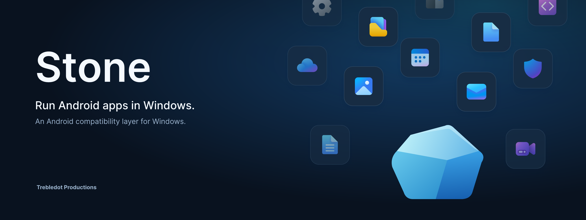

<p align="center">
  <picture>
      <source media="(prefers-color-scheme: light)" srcset="./docs/images/readme/stone-hero.light.png" />
      
  </picture>
</p>

<h1 align="center">Stone</h1>

<p align="center">Run Android apps in their own windows on Windows.</p>

<p align="center">
  <a href="#features">Features</a> ·
  <a href="#installation-and-quick-start">Quick Start</a> ·
  <a href="docs/README.md">Documentation</a> ·
  <a href="#contributing">Contributing</a>
</p>

Stone is an Android compatibility layer for Windows that runs APKs in its own Win32 windows, without an emulator, virtual machine, or ADB. By default, it uses ART, the AOSP framework, and native libraries from a system image selected by the user to execute the APK's original DEX directly.

The project is still in development, with Windows x64 as the primary runtime platform. Compatibility depends on the system image, ABI, and APIs used by each application.

## Features

The table below links to the documentation for each feature. Refer to those documents for specific support and limitations.

| Feature | Description |
| --- | --- |
| [ART and System Images](docs/runtime/art.md) | Uses a complete, read-only Android system image, with support for ext4 and the corresponding EROFS layouts; the framework, fonts, configuration, and CAs come from the image. |
| [Windows, Drawing, and Input](docs/android/graphics-input.md) | Win32 software windows, mouse and text input, window scaling, language and theme synchronization, and capture protection. |
| [Application Lifecycle](docs/android/lifecycle.md) | Activity routing, state restoration, and application component lifecycles. |
| [Installation and Updates](docs/android/packages.md) | Image-based manifest parsing and signature verification, installation confirmation, package registration, upgrades, and recovery. |
| [Files and Storage](docs/android/storage.md) | Private application data, shared volumes, document URIs, and file access authorization with identity checks. |
| [Networking](docs/android/network.md) and [Audio](docs/android/audio.md) | Networking, TLS, local communication, and audio/media adaptation, each with its own compatibility boundaries. |
| [Background Tasks and Power](docs/android/system-services.md) | Host power snapshots, supported wake locks, JobScheduler, and foreground services. |
| [Windows Desktop Integration](docs/windows/integration.md) | System notifications and restricted action recovery, plain-text clipboard, share panel, browser, and application entry points. |
| [StoneSettings](docs/windows/settings.md) | WinUI settings interface for image selection, application management, permissions, and native confirmation windows. |

### Execution Paths and Compatibility

| Windows Host | Execution Path | Current Status |
| --- | --- | --- |
| x64 | x86_64 image ART | Primary runtime path; executes original DEX/APK directly. |
| x64 | arm64-v8a image ART | Experimental ARM64-to-x64 translation; automatically enables ART Java JIT. |
| ARM64 | Native ART | Can be built; APK execution and the package management backend are not yet implemented. |

ART supports Java JIT and [APK AOT](docs/runtime/art-aot.md) through `--enable-jit` and `--enable-aot`. Both options can be used together; neither is explicitly enabled by default for x86_64 images. ARM64 native blocks and the [disk cache](docs/runtime/arm64-translation-cache.md) are separate experimental features, disabled by default.

## Installation and Quick Start

### Runtime Requirements

- **Windows x64** and an APK.
- **A complete Android system image**; a standalone `framework-res.apk` cannot replace a complete image.

Image preparation and APK execution use the bundled native image tool and Android ART; no Windows JDK or JVM is required.

Stone runs applications with the current Windows user's privileges and **does not provide a complete Android sandbox**. Run only APKs from trusted sources. Supported features and limitations are described in the linked feature documentation; installation or a visible window alone does not establish application compatibility.

### Obtaining Runtime Artifacts

To build from source, prepare the toolchain and SDK paths in the [build instructions](docs/development/build.md#tool-dependencies). JDK 21 is a build-time dependency for the ART bootstrap DEX and JNI headers.

Run from the repository root:

```powershell
$ARCH = 'x64'
cmake --preset $ARCH
cmake --build "build/$ARCH" --config Debug -- /restore
```

After a successful build, runtime artifacts are in `bin/x64/Debug/`, with the settings application in its `settings/` subdirectory. To build only the native components, add `-DSTONE_BUILD_SETTINGS=OFF` when configuring. See the [build instructions](docs/development/build.md) for dependency paths, ARM64 cross-compilation, and publishing commands.

The repository also provides MSI, MSIX, and MSIXBundle packaging targets, which must be explicitly enabled and are not part of the default build. See [Windows packages](docs/windows/packaging.md) for installation methods, signing, and dependencies. Packages do not include Android system images or a JDK.

### Launching an APK

From the repository root, enter the build output directory and replace the example APK and image paths with your own. This Debug example launches Client directly and keeps application data, temporary files, and logs under `bin/x64/Debug/test/manual/`:

```powershell
Set-Location bin/x64/Debug
$runRoot = Join-Path $PWD 'test/manual'
$env:TEMP = $env:TMP = Join-Path $runRoot 'temp'
New-Item -ItemType Directory -Force -Path $env:TEMP | Out-Null
$env:STONE_LOG_DIRECTORY = Join-Path $runRoot 'logs'
.\StoneClient.exe --help
.\StoneClient.exe --apk 'C:\Apps\sample.apk' --system-image 'C:\Images\system.img' `
  --data-dir (Join-Path $runRoot 'data')
```

Installed StoneService runs as an automatic Windows SCM service under LocalSystem. It supervises a broker under each signed-in user's token in that user's Windows session. Each broker launches a separate StoneClient for each ordinary APK; StoneClient hosts ART and the application window. Background components may continue running after the window closes. The SCM host does not execute ART or handle user desktop requests. Source builds can use an on-demand user broker without service registration.

Without the overrides above, Android application data and caches default to `%LOCALAPPDATA%\Trebledot Productions\Stone\User Data`, and logs default to the sibling `Logs` directory. If `--system-image` is omitted, Stone first uses the image selection saved in the data root, then falls back to `system.img` next to the executable. See [using Stone](docs/usage.md) for broker-based launches, arguments, and persistent JIT/AOT configuration, and [diagnostics](docs/development/diagnostics.md) for log collection. The environment overrides above apply to the current PowerShell session; use a fresh session for ordinary launches.

## Documentation

Browse all topics in the [documentation index](docs/README.md), or choose an entry point by task:

| Task | Documentation |
| --- | --- |
| Launch applications, select images, and configure ART | [Using Stone](docs/usage.md) |
| Configure the toolchain, build, publish, and run component tests | [Build Instructions](docs/development/build.md) |
| Understand process responsibilities and source organization | [Architecture Overview](docs/architecture/overview.md), [Native Layers](docs/architecture/native-layers.md) |
| Troubleshoot image preparation, loading, VM, and application issues | [Logging and Diagnostics](docs/development/diagnostics.md) |
| Modify code and validate behavior | [Repository Guidelines](AGENTS.md), [Integration Validation Drivers](test/windows/integration/) |

## Compatibility Limits

Compatibility gaps include:

- JNI class loader namespaces, and compatibility with more images and native libraries.
- The main WebView flow, hardware Surface interoperability, and full IME support.
- On-demand reading of complete system image resources, and background recovery across reboots or sign-ins.

See the feature documentation for the scope and limitations of each execution path.

## Contributing

Contributions are welcome through issue reports, compatibility evidence, documentation improvements, and code. Before starting, read [CONTRIBUTING.md](CONTRIBUTING.md) for component responsibilities, code formatting, build, and testing requirements.

Use the [bug report template](https://github.com/Trebledot/Stone/issues/new?template=bug_report.yml) and follow the [issue reporting requirements](CONTRIBUTING.md#reporting-issues) to provide reproducible compatibility evidence.

## Third-Party Notices

See the [third-party notices](docs/third-party/THIRD_PARTY_NOTICES.txt) for third-party components retained in the repository, their sources, and license files. ART, the AOSP framework, and system libraries come from the system image selected by the user and are not distributed with the repository.
